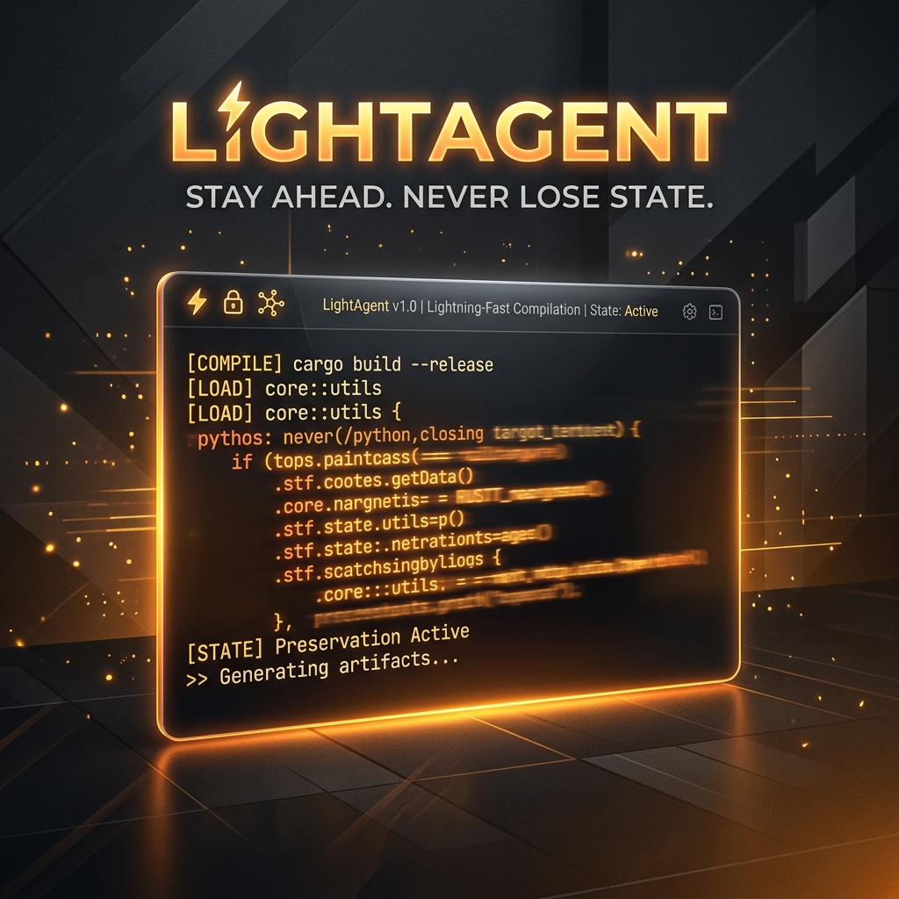

# LightAgent ⚡

<p align="center">
  
</p>

**LightAgent** is a blazingly fast, zero-dependency, state-preserving terminal AI coding assistant written in Rust. 

Unlike heavy, bloated agent frameworks that crash, consume gigabytes of RAM, require constant confirmations, and lose their memory during branch switches or restarts, LightAgent is built for **speed, local privacy, and absolute resilience**.

---

## 🌟 Key Features

* 🚀 **Zero Dependencies**: Compiled to a single static binary. No Python environment, node_modules, or heavy runtimes required.
* 💾 **State-Preserving (.agent/ jsonl)**: Saves every execution step, command stdout, and compiler output inside a local `.agent/state.jsonl` file. If your system restarts, terminal disconnects, or you switch git branches, LightAgent aligns itself with your Git commit history and resumes *exactly* where it left off.
* 🤖 **YOLO Mode**: Enable `--yolo` mode and let the agent run, edit files, compile, and execute tests autonomously in a loop until your test suite passes. No constant confirmation prompts.
* 🎛️ **Ollama Native**: Defaults to running against local models (like `qwen2.5-coder`) at `http://localhost:11434` for free, 100% private execution. Also supports OpenAI and Anthropic APIs.

---

## 📦 Installation & Quickstart

### 1. Run via npx (Zero-Setup)
Run the agent instantly on any directory:
```bash
# Start a new task in YOLO mode
npx lightagent start "Fix the failing test in tests/auth.rs" --yolo

# Resume an interrupted task
npx lightagent resume --yolo
```

### 2. Install globally via NPM
```bash
npm install -g lightagent-cli

# Now use it directly
lightagent start "Refactor payment module"
```

### 3. Build from Source (Cargo required)
```bash
git clone https://github.com/anilcan-kara/lightagent.git
cd lightagent
cargo build --release

# Binary will be available at target/release/lightagent
```

### 4. Direct Binary Download
You can download the precompiled static binary for your platform directly from the GitHub Release assets:
- 💻 **Windows (x64)**: [lightagent-win32-x64.exe](https://github.com/anilcan-kara/lightagent/releases/download/v0.1.1/lightagent-win32-x64.exe)
- 🐧 **Linux (x64)**: [lightagent-linux-x64](https://github.com/anilcan-kara/lightagent/releases/download/v0.1.1/lightagent-linux-x64)
- 🐧 **Linux (ARM64)**: [lightagent-linux-arm64](https://github.com/anilcan-kara/lightagent/releases/download/v0.1.1/lightagent-linux-arm64)
- 🍎 **macOS (x64)**: [lightagent-darwin-x64](https://github.com/anilcan-kara/lightagent/releases/download/v0.1.1/lightagent-darwin-x64)
- 🍎 **macOS (ARM64)**: [lightagent-darwin-arm64](https://github.com/anilcan-kara/lightagent/releases/download/v0.1.1/lightagent-darwin-arm64)

---

## 🛠️ CLI Reference

```bash
Zero-Dependency, State-Preserving Agent CLI

Usage: lightagent <COMMAND>

Commands:
  start    Start a new engineering task
  resume   Resume the active task from the local state
  status   Show the status of the current task and git alignment
  clear    Clear the current active task state
  help     Print this message or the help of the given subcommand(s)
```

### Resuming & Git Alignment
When running `lightagent resume`, the tool compares the Git commit hash at task initialization with the current HEAD. If a branch switch or code modification has occurred, it alerts you of code drift:

```bash
$ lightagent resume
Resuming active task...
Warning: Git commit drift detected! Current commit differs from task start commit.
```

---

## 🛡️ License

MIT — Anilcan Kara
